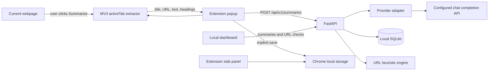

# BrieflyWeb

BrieflyWeb is a Manifest V3 Chrome extension with a FastAPI service and a no-build local dashboard. It supports user-triggered article summaries, encrypted local profile storage with explicit preview-and-approve autofill, a device-local knowledge library, and transparent URL-structure checks.

## Current status

Working in this repository:

- No-build runnable Chrome popup and side panel in `apps/extension/unpacked`; TypeScript/React sources are also included for the Vite build.
- User-triggered page extraction through `activeTab` and `scripting`, with canonical URL and headings, and a 100,000-character ceiling. The extension does not inject scripts across all browsing.
- Short, detailed, bullet, takeaways, simplified, and study-note summaries through an OpenAI-compatible backend adapter. Page text is labeled as untrusted source input in the model instruction.
- Summary persistence and retrieval in a local SQLite database through the API; extension-saved summaries also remain in device-local Chrome storage.
- A responsive dashboard served by FastAPI at `/dashboard/`, with recent summaries and URL checks.
- Preview-and-approve autofill for supported ordinary fields. The extension encrypts profile data with AES-GCM using a passphrase-derived key and never submits forms.
- Health check and explicit unconfigured responses for summary, video, and reputation capabilities.
- Citation-aware exam/interview answers use extracted PDF page markers; video summaries preserve caption timestamps when the page exposes them.
- Capture View stores a screenshot of the visible tab locally and supports visual Q&A about charts, diagrams, and layouts after the privacy preview is approved.
- One-click translate, simplify, save-selection, and save-page actions; privacy review before sending source content; clear controls for saved notes, the encrypted vault, and API keys.
- Connection health checks show provider, backend, PDF/OCR, caption, and URL-reputation readiness. The side panel expands to the available width.

Not implemented yet: account authentication, server-synced profiles, transcript integrations, a real video detector, external URL reputation, retrieval-augmented chat, PostgreSQL/pgvector migrations, rate limiting, and account data export/deletion. The current local SQLite API is a single-user development service and must not be exposed as a multi-user production service. Profile encryption is passphrase-based on this device; keep the passphrase safe because it cannot be recovered.

## Requirements

- Node.js 20+ and npm.
- Python 3.12+.
- Chrome or Chromium for loading the extension.
- Optional API key for an OpenAI-compatible chat completion endpoint.

## Install on another Windows PC

Copy the whole project folder to the new PC; the `apps/extension/unpacked` folder alone is not the complete application. The extension needs the local FastAPI backend for AI answers, PDF text extraction, and summary storage.

1. Install Python 3.12 or newer and Google Chrome 141 or newer.
2. In Chrome, open `chrome://extensions`, enable **Developer mode**, choose **Load unpacked**, and select `apps/extension/unpacked`.
3. Open the side panel, select **More → AI provider**, enter that PC owner's API address and model, then add up to three API keys in priority order and choose **Save AI connection**. If a request fails or returns an empty answer, BrieflyWeb retries the next saved key automatically. This enables full AI answers and summaries without running the local backend. Keys remain in that Chrome profile and are not part of the ZIP.
4. To enable whole-PDF extraction and the dashboard too, right-click `Run-BrieflyWeb.ps1` and choose **Run with PowerShell**. If Windows blocks the script, open PowerShell in the project folder and run `powershell -ExecutionPolicy Bypass -File .\Run-BrieflyWeb.ps1`. The first run installs backend packages and creates `backend/.env`. Set `LLM_API_KEY` in that private file only if you want the backend to provide AI as well; restart the script after editing it.

The API address defaults to `http://localhost:8000/api/v1` and can be changed from **More → Local AI service**. The included backend binds to localhost and is intended to run on the same computer as Chrome. LAN or public deployment needs a separately secured backend; authentication and multi-user isolation are not included. Each local install has separate browser storage, saved summaries, and encrypted autofill profile.

After loading unpacked, the extension UI, encrypted autofill, saved library, and local URL heuristics work without a backend. For full AI answers and summaries without the local backend, open **More → AI provider**, enter an OpenAI-compatible API address and model, then add up to three API keys in priority order and save. Requests automatically retry the next key if the previous key fails. Keys are stored in that Chrome profile and are excluded from the project ZIP. Without a key, webpage summaries and answers fall back to local extractive/passage matching. Scanned PDFs can use vision OCR on the currently visible page; scroll to another page and ask again to OCR it. This requires a direct AI key or a backend with a vision-capable model. Digital PDF extraction still uses the local backend. Video transcription, AI media detection, and external URL reputation are not implemented as real integrations.

## Local setup

1. Copy `.env.example` to `backend/.env`. Set `LLM_API_KEY`, `LLM_MODEL`, and optionally `LLM_BASE_URL` to enable summaries. No provider key is needed for the URL heuristics. Set `EXTENSION_ID` if you want the API CORS policy to allow your loaded extension's origin.
2. Start the API:

   ```powershell
   cd backend
   python -m venv .venv
   .\.venv\Scripts\Activate.ps1
   pip install -e ".[dev]"
   uvicorn app.main:app --reload --port 8000
   ```

3. Open `http://localhost:8000/dashboard/` for the dashboard and `http://localhost:8000/docs` for the API schema.

4. Load the runnable extension:

   - In Chrome open `chrome://extensions`, enable Developer mode, and select **Load unpacked**.
   - Choose `apps/extension/unpacked`.
   - The unpacked manifest pins the extension ID, and the API allows that ID by default. If you edit the manifest key, set the resulting extension ID in `backend/.env` and restart the API.
   - Reload an ordinary article page, open BrieflyWeb, and summarize. The AI provider receives extracted page text only after the user starts a summary.

5. The React/Next source projects are optional and can be built after npm registry access is available:

   ```powershell
   npm install
   npm run dev:web
   ```

The no-build extension talks to `http://localhost:8000/api/v1` by default. If the API runs on a different computer, enter its API address in **More → Local AI service**.

## Docker

For local development, copy `.env.example` to `.env` in the repository root and run `docker compose up --build`. The API's SQLite file is stored in the `briefly-data` volume. The API serves the dashboard at `/dashboard/`.

## API

All routes are versioned under `/api/v1`:

| Method | Path | Behavior |
|---|---|---|
| POST | `/summaries` | Summarize supplied extracted text and persist the result |
| GET | `/summaries` | List summaries with `limit` and `offset` |
| GET | `/summaries/{id}` | Retrieve one summary |
| DELETE | `/summaries/{id}` | Delete one summary |
| POST | `/security/url-checks` | Return local URL-structure heuristics |
| POST | `/links/analyze` | Return heuristics and explicit disabled-fetch status; does not fetch URLs |
| POST | `/videos/analyze` | Explicitly reports that no detector is configured |
| POST | `/vision/qa` | Answer a question about a captured webpage image and visible text |
| GET | `/dashboard/` | Serve local dashboard |

OpenAPI is available at `/docs`; readiness information is at `/health`.

## Privacy and security

- The extension injects a page extractor only after a popup action; it does not transmit browsing history.
- Article text is sent to the API only when the user requests a summary. The backend then sends it to the configured provider. Do not use the service with sensitive pages unless that provider is approved for the content.
- A captured viewport stays in extension memory until the user asks a visual question and approves the preview; then the image and question go to the configured AI provider.
- Provider credentials remain in backend environment variables.
- URL checks do not contact the URL or a third party. The link analysis endpoint does not fetch arbitrary URLs, so it cannot serve as a link summarizer yet.
- URL results are heuristics. `LOW` does not mean verified safe; no reputation service is configured.
- The local API currently has no authentication or per-user isolation. Bind it to localhost only. Do not deploy it on a public network.
- Saved summaries are stored in Chrome local storage and the local SQLite API. Profile fields are encrypted in Chrome local storage using a passphrase-derived AES-GCM key.
- Autofill detects visible ordinary fields, shows proposed matches and values, and fills only selected fields after the user approves. Passwords, payment, government ID, hidden fields, and submission controls are excluded. The extension never submits a form.
- No video transcript provider, real media detector, or URL reputation integration is configured. Link analysis does not fetch URLs.

## Architecture



The TypeScript React popup and Next.js dashboard source have package scripts, but are not needed to run the included no-build extension and dashboard.

## Verification

Backend tests are in `backend/tests`. Run `cd backend; pip install -e ".[dev]"; pytest`. Build both frontend targets with `npm install`, `npm run build:extension`, and `npm run build:web`.

## Limitations and next work

This is a local single-user product build, not a production multi-user service. Do not expose the API to a public network. Summaries need an AI provider key. URLs are not fetched server-side until a DNS-pinned redirect-validating fetcher is implemented. Video transcription and generated-media assessment require separately configured, real providers; those features report unavailable states.
